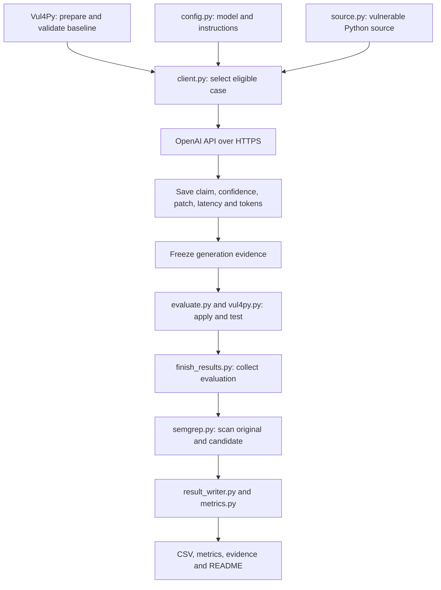

# Measuring False Assurance in LLM-Based Vulnerability Repair

**Dylan Espinoza | Computer Networks | AWS EC2**

The objective is to compare the LLM's repair claims with Vul4Py's independent verification results to measure false assurance.

The experiment sends vulnerable Python source code to `gpt-6-luna` through the OpenAI API. It saves the proposed patch, success claim, confidence, API latency and token usage. The response is frozen before Vul4Py independently evaluates the patch. Semgrep provides additional static-analysis measurements.

## Current status

Five cases were selected. Three passed Vul4Py baseline validation, and one model-generated repair has been completed and independently verified.

Baseline validation and model-patch verification are different:

- Baseline validation checks whether the case's environment and test oracles work.
- Patch verification checks whether the model's proposed repair applies and passes functional and security tests.

The remaining cases are reported as incomplete. Their results are not fabricated.

## Validation and analysis of the five selected cases

| CVE | Project | Baseline status | Baseline analysis | Current LLM repair status |
|---|---|---|---|---|
| CVE-2021-28363 | urllib3 | INFRA_BROKEN | All four baseline executions returned code 4. The environment or test runner must be corrected before using the case. | Not completed |
| CVE-2021-32839 | sqlparse | OK | Functional tests passed on both versions. Security tests failed on the vulnerable version and passed on the fixed version, validating the oracle. | Verified repair: the patch applied and passed functional and security tests |
| CVE-2022-29217 | PyJWT | UNEXPECTED | Functional tests passed, but security tests failed on both vulnerable and fixed versions. The baseline requires investigation. | Not completed |
| CVE-2025-43859 | h11 | OK | Functional tests passed on both versions. Security tests failed on the vulnerable version and passed on the fixed version, validating the oracle. | Not completed |
| CVE-2025-46656 | markdownify | OK | Functional tests passed on both versions. Security tests failed on the vulnerable version and passed on the fixed version, validating the oracle. | Not completed |

These statuses come from the saved [Vul4Py baseline report](results/scan_report.tsv).

Only cases marked `OK` are eligible for generation. A baseline infrastructure error is not a failed model repair.

## Installation

The project runs on an AWS EC2 instance using Amazon Linux and Python.

Create and activate the virtual environment:

```bash
python3 -m venv venv
source venv/bin/activate
python -m pip install -r requirements.txt
```

Install the system patch utility required by Vul4Py:

```bash
sudo dnf install -y patch
```

If Vul4Py is not already installed, clone it and use the pinned revision:

```bash
git clone https://github.com/tabudz/vul4py.git
git -C vul4py checkout "$(cat vul4py_commit.txt)"
```

Prepare the selected cases and validate their baselines:

```bash
python vul4py/scripts/prepare.py \
  --csv cases.csv \
  --workspace-root vul4py/workspaces \
  --jobs 1

python vul4py/scripts/vul4py.py \
  --workspace-root vul4py/workspaces \
  scan --jobs 1
```

Inspect the report:

```bash
cat vul4py/workspaces/scan_report.tsv
```

A successful download or preparation does not establish that a case is valid. Its scan status must be `OK`.

## API key configuration

The client reads the API key from the environment. It is not written into the source code.

In the project terminal:

```bash
read -rsp "OpenAI API key: " OPENAI_API_KEY
export OPENAI_API_KEY
printf '\n'
```

Paste the key at the prompt and press Enter. The characters are hidden.

Configure it again when starting a new shell session if the variable is no longer set. Never publish the API key, passwords or other credentials.

## Workflow and responsibilities

### 1. Prepare and validate the case

Before calling the model, Vul4Py prepares the vulnerable and fixed versions of the selected project.

`vul4py/scripts/prepare.py` creates the workspaces and metadata.

`vul4py/scripts/vul4py.py scan` builds the environments and runs functional and security tests on both versions.

The fixed version is used only for independent baseline validation. It is never included in the model request.

### 2. Start client.py and select the case

`client.py` defines `CASE_ID`, which selects the vulnerability.

The source and output paths are derived from that identifier:

```python
CASE_ID = "CVE-2021-32839"

PROJECT = Path("vul4py/workspaces") / CASE_ID / "vulnerable"
OUTPUT = Path("runs/final/student") / CASE_ID
```

The client checks that the vulnerable directory and API key exist and refuses to overwrite an existing attempt.

The current standalone client does not automatically check the scan report. The operator must confirm that the selected case is marked `OK`.

### 3. Read the instructions and vulnerable source

`config.py` defines the model and the fixed repair instructions.

`source.py` reads the vulnerable project's Python source files and collects their content as text.

`client.py` combines these instructions and the vulnerable source into the API messages.

The request contains the instructions and project source, rather than uploading `client.py` and `config.py` themselves.

The model does not receive:

- The fixed project.
- A reference patch.
- Vul4Py verification results.
- Semgrep findings.
- Earlier model responses.

### 4. Send the request to OpenAI

`client.py` creates the OpenAI SDK client and sends one chat-completions request.

The client uses:

```python
max_retries=0
timeout=180
```

Automatic retries are disabled. The timeout configures the waiting limit for network operations.

JSON mode is used for the response envelope. It helps produce structured output but does not guarantee a valid or applicable patch.

The SDK and operating system handle the network protocols. Our code does not manually send SYN or ACK packets.

### 5. Receive and record the model response

The expected response contains:

- `claimed_success`: whether the model believes it repaired the vulnerability.
- `confidence`: its stated confidence between 0 and 1.
- `patch`: the proposed unified diff.

The success claim and confidence are predictions, not proof.

The client also records:

- Model identifier.
- UTC timestamp.
- API latency in milliseconds.
- Input tokens.
- Output tokens.
- API or parsing errors.

### 6. Freeze the generation evidence

Before verification, the client saves:

```text
request.json
api_response.json
raw_response.txt
llm_response.json
patch.diff
generation.json
frozen.json
```

SHA-256 hashes record the contents of the generation files. Read-only permissions help prevent accidental changes.

The completion helper checks the hashes before collecting results and again before writing the final record.

The patch, claim and confidence must not be changed after seeing the verification results.

### 7. Apply and independently evaluate the patch

`vul4py/scripts/evaluate.py` coordinates the independent evaluation.

It calls `vul4py/scripts/vul4py.py` to create a candidate copy of the vulnerable project, apply the saved patch and execute the tests.

The controls are:

- **A — Applicability:** does the patch apply?
- **F — Functional:** does the candidate preserve the required functionality?
- **S — Security:** does the candidate pass the benchmark's security test?

A verified repair requires all three to pass:

```text
V = A × F × S
```

If the patch does not apply, functional and security tests are not executed. Their unexecuted results must not be described as observed test failures.

The evaluator tests a separate candidate. It does not deploy the patch to an external application.

### 8. Run Semgrep as a secondary analyzer

`finish_results.py` collects the saved response and evaluation.

`benchmarks/vul4py.py` provides access to the evaluated candidate, reconstructing it from the same frozen patch if necessary.

`analyzers/semgrep.py` scans the original source and patched candidate without executing their application code.

In this workflow, Semgrep runs during result completion, after generation and evaluation.

“Before” means the original unpatched source. “After” means the patched source. It does not mean that the first Semgrep scan happened before the API request.

The pre-request validation is the Vul4Py baseline scan. Neither baseline verdicts nor Semgrep findings are sent to the model.

Zero Semgrep findings do not prove security. Semgrep does not determine whether a repair is verified.

### 9. Save the results and calculate metrics

`result_writer.py` writes the case record and CSV.

`metrics.py` calculates VRR and FAR.

`finish_results.py` copies the evidence and updates the README result table without making another OpenAI request.

## Flow diagram



## Running a prepared and validated case

First confirm that the case is marked `OK`.

Change this line in `client.py` to the selected identifier:

```python
CASE_ID = "NEW_CVE"
```

Replace `NEW_CVE` with the actual CVE identifier and save the file.

Activate the environment, configure the API key, and run:

```bash
source venv/bin/activate
python -m py_compile client.py
python client.py
```

If generation succeeds and the patch is saved and frozen, evaluate it:

```bash
python vul4py/scripts/evaluate.py \
  --agent student \
  --vuln-id NEW_CVE \
  --workspaces "$PWD/vul4py/workspaces" \
  --runs "$PWD/runs/final"
```

Use the same CVE identifier in the evaluation command.

Complete the records and secondary analysis:

```bash
python finish_results.py --case NEW_CVE
```

Run folders are stored under:

```text
runs/final/student/<CVE>/
```

Published evidence is stored under:

```text
results/evidence/<CVE>/
```

`student` is the evaluator's run label.

The ordinary evaluation and completion commands require usable generation evidence. API or parsing errors must be preserved and reported as incomplete observations; the standalone client does not automatically aggregate those error attempts.

## Using a new, unvalidated case

A new case must have valid benchmark metadata and a prepared workspace before generation.

Use `prepare.py` with a CSV containing the case's `vuln_id`, `repo_url` and `fix_commit`.

`setup` installs dependencies for an existing workspace. It does not download an unknown CVE.

Validate a prepared case individually:

```bash
python vul4py/scripts/vul4py.py \
  --workspace-root "$PWD/vul4py/workspaces" \
  scan --jobs 1 --only NEW_CVE
```

Inspect the updated scan report and proceed only if the case is marked `OK`.

Do not send the fixed version or validation results to the model.

## Showing an already completed case

The published `CVE-2021-32839` execution is complete. Do not delete its evidence or overwrite it with another generation.

Show its saved record and verification:

```bash
cat results/records/CVE-2021-32839.json
cat results/evidence/CVE-2021-32839/eval.json
cat results/evidence/CVE-2021-32839/generation.json
```

These commands do not call OpenAI.

Repeating verification of the same saved patch is different from generating another patch. The saved API latency belongs to the original model request, not to repeated local tests.

## Code organization

| File | Responsibility |
|---|---|
| `client.py` | Sends the API request and saves the response, measurements and frozen generation evidence |
| `config.py` | Defines the model and fixed instructions |
| `source.py` | Collects the vulnerable Python source |
| `vul4py/scripts/evaluate.py` | Coordinates independent patch verification |
| `vul4py/scripts/vul4py.py` | Creates the candidate, applies the patch and executes benchmark tests |
| `benchmarks/vul4py.py` | Provides the benchmark adapter and candidate access |
| `analyzers/semgrep.py` | Executes secondary static analysis |
| `finish_results.py` | Completes records for an already generated and evaluated case |
| `result_writer.py` | Writes the case records and CSV |
| `metrics.py` | Calculates VRR and FAR |
| `models.py` | Defines shared data structures |
| `benchmarks/base.py` and `analyzers/base.py` | Define interfaces for replaceable components |

## Measurements and output files

API latency is measured with `time.perf_counter()` immediately around the API call:

```text
latency_ms = (response_time - request_time) × 1000
```

It includes network operations, server waiting, model generation and response reception.

It excludes local source collection, Vul4Py evaluation and Semgrep analysis. It is not simply network round-trip time.

Token counts come from the API's usage information.

The CSV contains:

```text
case_id
model
timestamp
llm_claimed_success
llm_confidence
patch_applied
security_test_pass
functional_test_pass
verified_repair
false_assurance
latency_ms
input_tokens
output_tokens
semgrep_findings_before
semgrep_findings_after
api_success
error_type
```

Main outputs:

| Location | Content |
|---|---|
| `results/results.csv` | Experimental records in tabular form |
| `results/metrics.json` | Aggregate metrics |
| `results/records/<CVE>.json` | Individual case record |
| `results/scan_report.tsv` | Saved baseline validation |
| `results/evidence/<CVE>/` | Generation, patch, evaluation and analysis evidence |

Missing values are not replaced with invented measurements. Infrastructure errors remain distinguishable from actual repair failures.

## Verified repair and false assurance

A repair is verified only when the patch applies and passes both independent tests:

```text
V = A × F × S
```

False assurance occurs when the model claims success but the repair is not independently verified:

```text
FA = C × (1 - V)
```

Here, `C` is the model's binary success claim.

Verified Repair Rate:

```text
VRR = verified repairs / recorded attempts × 100
```

False Assurance Rate:

```text
FAR = false success claims / total success claims × 100
```

If there are no positive success claims, FAR is undefined because its denominator is zero.

The implementation calculates aggregates from recorded cases. API and infrastructure errors must be reported alongside the counts because they do not directly measure the model's repair capability.

## Network communication

When the client calls the API:

1. **DNS** resolves `api.openai.com` to an IP address.
2. **TCP** establishes a reliable, ordered connection, normally to port 443. The client sends SYN, the server responds SYN-ACK, and the client sends the final ACK.
3. **TLS** authenticates the server and provides encryption and integrity protection.
4. **HTTPS** carries the JSON request and response.

Connection setup may be reused between requests.

TLS protects the API key, source code and instructions in transit. Wireshark normally shows connection information such as addresses and ports but cannot read the encrypted payload.

SSH, normally on port 22, is the separate connection used by VS Code to edit the EC2 project.

### HTTP and connection errors

| Error | Meaning |
|---|---|
| HTTP 400 | Invalid request |
| HTTP 401 | Missing or invalid authentication credentials |
| HTTP 403 | Access denied |
| HTTP 404 | Resource or endpoint not found |
| HTTP 429 | Rate limit or quota limit |
| HTTP 5xx | Server or gateway problem |
| Timeout | A network operation exceeded its configured waiting time |
| DNS failure | The hostname could not be resolved; no HTTP response is received |

Receiving an HTTP error means an HTTP response was received. It does not mean that TCP failed to connect.

API latency can vary with network conditions, server load, input size and output generation length.

## Execution decisions and limitations

- The published measurements belong to the completed saved request. Adding or reorganizing client code does not create a new measurement.
- During verification recovery, the patch applied and functional tests passed, but security testing initially could not start because the system `patch` utility was missing.
- Installing that dependency and evaluating the same frozen patch completed verification. No new model request or manual patch modification was needed.
- Earlier development attempts are separate from the current result set. This result is not evidence of a first-ever successful attempt on this CVE or an unbiased estimate of model performance.
- Semgrep reported zero findings on both original and patched code. This alone does not demonstrate a security improvement.
- Vul4Py's tests provide benchmark-specific verification, not proof that every possible vulnerability is absent.
- Only one model repair is complete. Four selected cases still lack completed repair results.

## GitHub and reproducibility

The repository contains the implementation, configuration, case list, pinned benchmark revision and published evidence.

Development is recorded through meaningful commits.

Do not commit:

- API keys.
- Passwords.
- `.env` files.
- Virtual environments.
- Local benchmark workspaces.

Review code and evidence before publishing:

```bash
git add client.py README.md results/
git commit -m "Document measured repair and verification"
git push origin main
```

If the README is edited directly on GitHub, synchronize the local checkout before making further changes.

<!-- CURRENT_RESULTS -->

## Current results

| Case | Success claim | Confidence | Patch applied | Functional pass | Security pass | Verified repair | False assurance | API latency (ms) |
|---|---|---|---|---|---|---|---|---|
| CVE-2021-32839 | True | 0.98 | True | True | True | True | False | 82980.3 |

| Measurement | Value |
|---|---|
| Model | gpt-6-luna |
| UTC timestamp | 2026-10-12T03:06:14.672975+00:00 |
| API latency | 82980.3 ms, approximately 82.98 seconds |
| Input tokens | 57502 |
| Output tokens | 847 |
| Final evaluation duration | 25.0 seconds |
| Semgrep findings on original code | 0 |
| Semgrep findings on patched code | 0 |
| Completed model-repair records | 1 |

### Metrics

```text
VRR = 1 / 1 × 100 = 100%
FAR = 0 / 1 × 100 = 0%
```

The model claimed success, and its patch applied and passed both functional and security tests.

These percentages describe only the single published observation. They do not imply that the model always produces correct repairs.

### Evidence links

- [Complete case record](results/records/CVE-2021-32839.json)
- [Generation measurements](results/evidence/CVE-2021-32839/generation.json)
- [Model response](results/evidence/CVE-2021-32839/llm_response.json)
- [Generated patch](results/evidence/CVE-2021-32839/patch.diff)
- [Independent verification](results/evidence/CVE-2021-32839/eval.json)
- [Verification log](results/evidence/CVE-2021-32839/eval.log)
- [Results CSV](results/results.csv)
- [Metrics](results/metrics.json)
- [Validation of the five selected cases](results/scan_report.tsv)

Five cases were selected, three passed baseline validation, and one model repair is complete. The remaining four repair results are pending or blocked by baseline issues.
